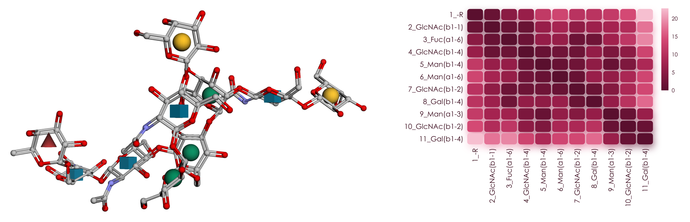
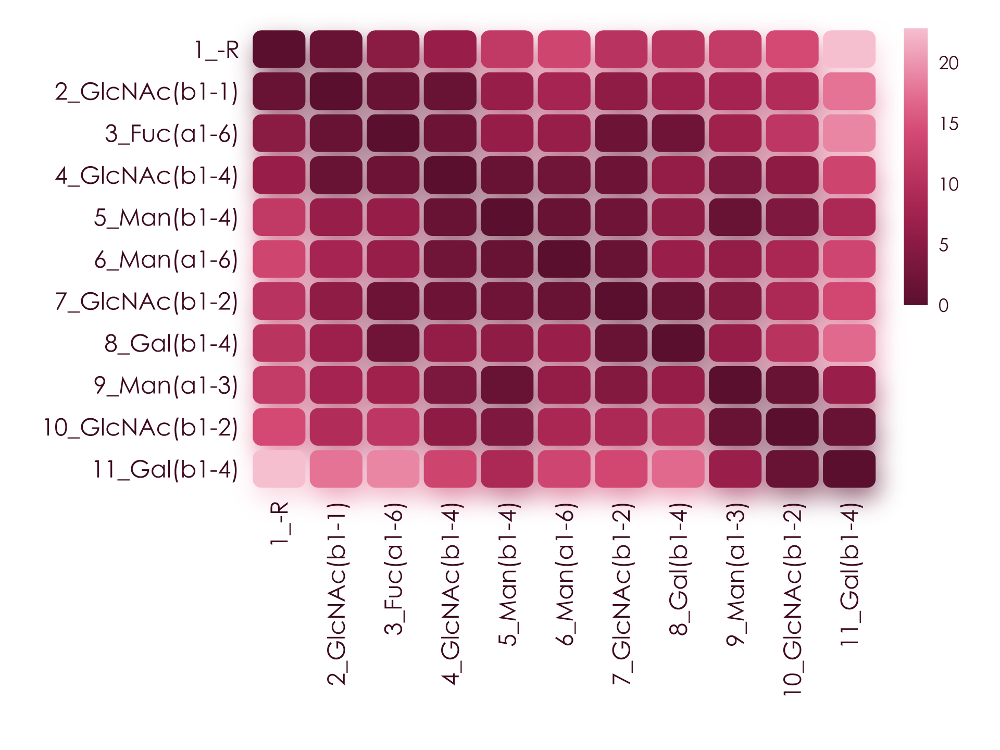
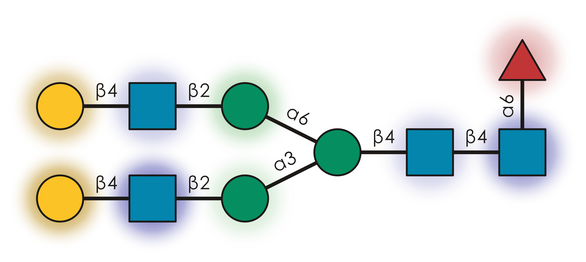
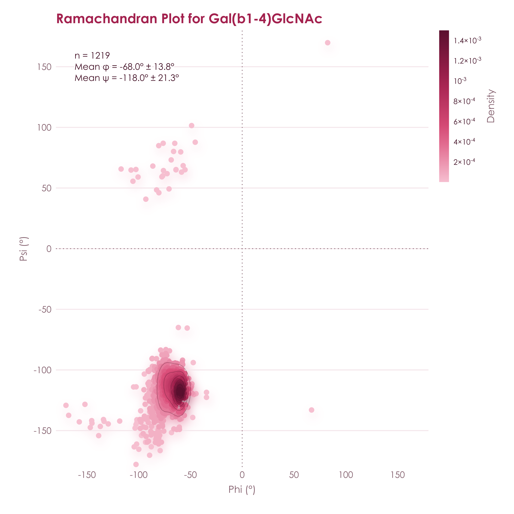
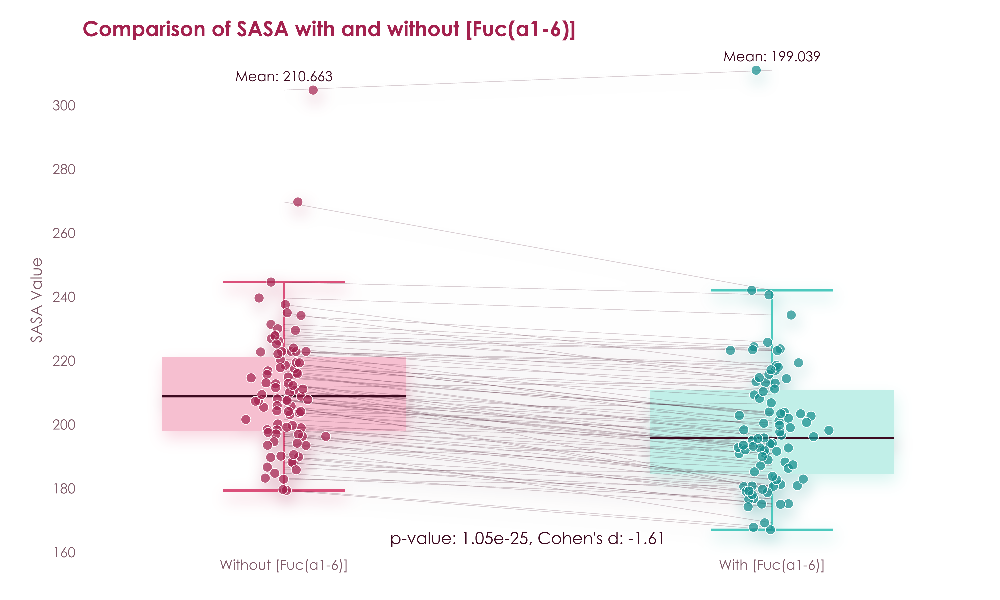
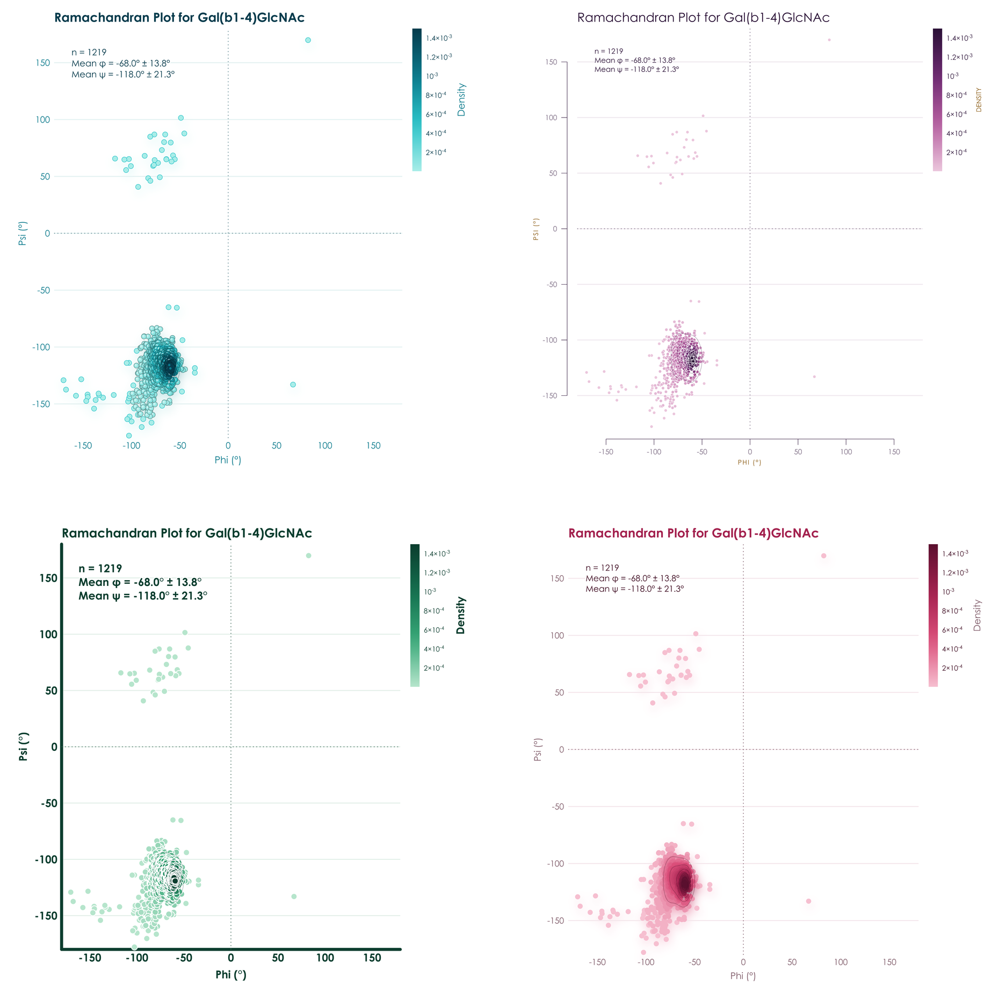

<h1 align="center">GlyContact</h1>

<p align="center"><strong>Glycan 3D structures, analyzed at scale.</strong><br>
Hand it a sequence. It brings the conformers and returns contacts, surface accessibility, flexibility, torsions, and hydrogen bonds.</p>

<p align="center">
<a href="https://pypi.org/project/glycontact/"></a>
<a href="https://pypi.org/project/glycontact/"></a>
<a href="https://github.com/BojarLab/glycontact/actions/workflows/testing.yml"></a>
<a href="https://codecov.io/gh/BojarLab/glycontact"></a>
<a href="https://bojarlab.github.io/glycontact/"></a>
<a href="https://www.nature.com/articles/s41467-025-67590-y"></a>
</p>

<p align="center"></p>

Glycans are branched and flexible, so much of their function lives in a 3D landscape that a linear sequence only hints at. GlyContact connects the sequence you already have to atomic-resolution structures from GlycoShape molecular dynamics, NMR, or X-ray crystallography, and turns them into numbers, figures, and machine learning features.

- **Sequence in, structures out.** Pass an IUPAC sequence and GlyContact fetches its conformers from the GlycoShape API and caches them. Your own PDB files work the same way, through `my_path`.
- **Ensembles, not snapshots.** Contact frequencies, torsions, and hydrogen bonds are computed across conformer clusters and weighted by their populations.
- **Free, bound, and attached.** Binding pockets, per-contact interaction classes, and glycan shielding cover lectin complexes and glycoproteins alike.
- **Ready for machine learning.** 1,476 annotated structure graphs ship with the package, and the `[ml]` extra trains models that sample structure ensembles for any sequence.
- **Figures worth publishing.** Every plot is drawn with [viscose](https://github.com/BojarLab/viscose), and one word changes its palette.

**Documentation:** <https://bojarlab.github.io/glycontact/> · **Examples:** [lectin complexes and glycoproteins](https://colab.research.google.com/github/BojarLab/glycontact/blob/main/examples.ipynb) · **Cite:** [Thomès et al., 2025](https://www.nature.com/articles/s41467-025-67590-y)

## Install

```bash
pip install glycontact
pip install "glycontact[ml]"   # adds torch and torch-geometric for the machine learning layer
```

## See it in 3D

`plot_glycan_3D` draws any conformer with 3D-SNFG symbols in an interactive py3Dmol view, inside your notebook. The structure at the top of this page comes from this call.

```python
from glycontact.visualize import plot_glycan_3D
glycan = "Gal(b1-4)GlcNAc(b1-2)Man(a1-3)[Gal(b1-4)GlcNAc(b1-2)Man(a1-6)]Man(b1-4)GlcNAc(b1-4)[Fuc(a1-6)]GlcNAc"
plot_glycan_3D(glycan)
```

## Contact maps

Contact maps show which monosaccharides sit close together in space, and so which parts of a glycan act as one surface. You get one table per conformer cluster, with the closest contacts drawn darkest.

```python
from glycontact.process import get_contact_tables
from glycontact.visualize import draw_contact_map
contact_tables = get_contact_tables(glycan, level = "monosaccharide")
draw_contact_map(contact_tables[0], size = 1.0)
```

<p align="center"></p>

## Surface accessibility and flexibility

Solvent-accessible surface area and flexibility decide what a binding partner can reach. `plot_glycan_score` paints them straight onto the SNFG drawing, with the most exposed residues glowing strongest.

```python
from glycontact.visualize import plot_glycan_score
plot_glycan_score(glycan, attribute = "SASA")
```

<p align="center"><picture><source media="(prefers-color-scheme: dark)" srcset="https://raw.githubusercontent.com/BojarLab/glycontact/main/README_files/sasa_dark.png"></picture></p>

## Torsion angles

Glycosidic torsions set the overall shape of a glycan. `ramachandran_plot` pools them across every structure that carries a linkage.

```python
from glycontact.visualize import ramachandran_plot
fig = ramachandran_plot("Gal(b1-4)GlcNAc")
```

<p align="center"></p>

`get_linkage_conformations` gives the same view for one glycan, weighted by conformer population and with gg/gt/tg rotamers for linkages to O6.

```python
from glycontact.process import get_linkage_conformations
print(get_linkage_conformations(glycan).head().to_string(index = False))
```

```text
      linkage  n_conformers  phi_mean  phi_sd  psi_mean  psi_sd  omega_mean  omega_sd  gg  gt  tg
 10_NAG-9_MAN             5    -80.07   12.60    167.23    5.29         NaN       NaN NaN NaN NaN
11_GAL-10_NAG             5    -64.52    5.33   -116.76    8.54         NaN       NaN NaN NaN NaN
  3_FUC-2_NAG             5    -76.55    2.46    177.25   13.46      -83.72     10.23 1.0 0.0 0.0
  4_NAG-2_NAG             5    -76.48    3.29   -121.53    9.13         NaN       NaN NaN NaN NaN
  5_BMA-4_NAG             5    -84.01   38.24   -123.50   15.52         NaN       NaN NaN NaN NaN
```

## Hydrogen bonds

`get_hydrogen_bonds` finds the inter-residue hydrogen bonds that hold a conformation together, with their occupancy across the ensemble.

```python
from glycontact.process import get_hydrogen_bonds
print(get_hydrogen_bonds(glycan).head().to_string(index = False))
```

```text
 donor_residue        donor donor_atom  acceptor_residue     acceptor acceptor_atom  occupancy  distance  angle
            10 GlcNAc(b1-2)         O3                11    Gal(b1-4)            O5        0.8      3.00 141.68
             4 GlcNAc(b1-4)         N2                 3    Fuc(a1-6)            O2        0.6      3.01 156.65
             2 GlcNAc(b1-1)         O3                 4 GlcNAc(b1-4)            O5        0.6      2.80 141.05
             7 GlcNAc(b1-2)         O3                 8    Gal(b1-4)            O5        0.6      2.80 159.19
             3    Fuc(a1-6)         O2                 7 GlcNAc(b1-2)            O3        0.4      2.79 157.55
```

## What a motif does to a structure

`find_difference` compares every pair of glycans that differ only by a motif and tests the change in any structural property.

```python
from glycontact.process import structure_graphs
from glycontact.visualize import find_difference
result = find_difference(list(structure_graphs), pattern = "[Fuc(a1-6)]", metric = "SASA", plot = True)
```

<p align="center"></p>

## Glycans bound to proteins

`glycontact.structure` works on any PDB file. It reads the glycans out of it and classifies every contact with the protein into hydrogen bonds, CH-π stacking, metal coordination, covalent bonds, and van der Waals contacts.

```python
from glycontact.structure import get_glycan_sequences_from_pdb, get_glycan_protein_interactions
print(get_glycan_sequences_from_pdb("3ZW1.pdb"))
interactions = get_glycan_protein_interactions("Fuc(a1-3)[Gal(b1-4)]GlcNAc(b1-3)Gal", "3ZW1.pdb")
print(interactions.head().to_string(index = False))
```

```text
['Fuc(a1-3)[Gal(b1-4)]GlcNAc(b1-3)Gal', 'Fuc(a1-3)GlcNAc']
glycan_chain glycan_residue     IUPAC glycan_atom chain  resSeq resName protein_atom  distance   interaction
           D          4_GAL Gal(b1-4)          O6     A       8     TRP          NE1  3.254790 hydrogen_bond
           D          3_FUC Fuc(a1-3)          O5     A      15     ARG          NH2  2.825438 hydrogen_bond
           D          3_FUC Fuc(a1-3)          O4     A      15     ARG           NE  2.905937 hydrogen_bond
           D          3_FUC Fuc(a1-3)          O5     A      15     ARG           NE  3.352896 hydrogen_bond
           D          4_GAL Gal(b1-4)          C6     A      15     ARG          NH2  3.831360 van_der_Waals
```

## One word, four palettes

Every plotting function takes `palette`, and `viscose.set_palette` sets one for a whole session.

```python
fig = ramachandran_plot("Gal(b1-4)GlcNAc", palette = "lumen")
```

<p align="center"></p>

## Everything in the box

| | |
|---|---|
| **Retrieve** | `download_from_glycoshape`, `get_example_pdb`, `fetch_pdbs`, `convert_ID`, `get_all_clusters_frequency`, `extract_3D_coordinates` |
| **Contacts** | `get_contact_tables`, `make_atom_contact_table`, `make_monosaccharide_contact_table`, `inter_structure_frequency_table`, `inter_structure_variability_table` |
| **Surface and flexibility** | `get_sasa_table`, `compute_merge_SASA_flexibility`, `calculate_torsion_flexibility_per_residue` |
| **Geometry** | `get_glycosidic_torsions`, `get_linkage_conformations`, `get_ring_conformations`, `get_hydrogen_bonds`, `analyze_torsion_torsion_correlations` |
| **Proteins** | `get_binding_pocket`, `get_glycan_shielding`, `get_glycan_protein_interactions`, `get_glycan_sequences_from_pdb`, `annotation_pipeline` |
| **Comparison** | `superimpose_glycans`, `get_similar_glycans`, `find_difference` |
| **Plots** | `draw_contact_map`, `plot_glycan_3D`, `plot_glycan_score`, `plot_superimposed_glycans`, `plot_monosaccharide_instability`, `ramachandran_plot`, `show_correlations`, `show_correlation_dendrogram`, `make_gif` |
| **Machine learning** | `get_all_structure_graphs`, `create_dataset`, `train_model`, `evaluate_model`, `predict_structure_ensemble`, `GINSweetNet`, `VonMisesSweetNet` |

The [documentation](https://bojarlab.github.io/glycontact/) covers each of them, and [`examples.ipynb`](https://colab.research.google.com/github/BojarLab/glycontact/blob/main/examples.ipynb) and [`ConformerLearning.ipynb`](https://colab.research.google.com/github/BojarLab/glycontact/blob/main/ConformerLearning.ipynb) walk through lectin complexes, glycoproteins, and conformer prediction.

## Citation

If you use GlyContact in your research, please cite [Thomès et al., GlyContact analyzes glycan 3D structures at scale. *Nat Commun* 16:11136, 2025](https://www.nature.com/articles/s41467-025-67590-y).

## Contributing and license

Contributions are welcome, so please feel free to open a pull request. GlyContact is released under the MIT License, as detailed in the [LICENSE](https://github.com/BojarLab/glycontact/blob/main/LICENSE) file.
